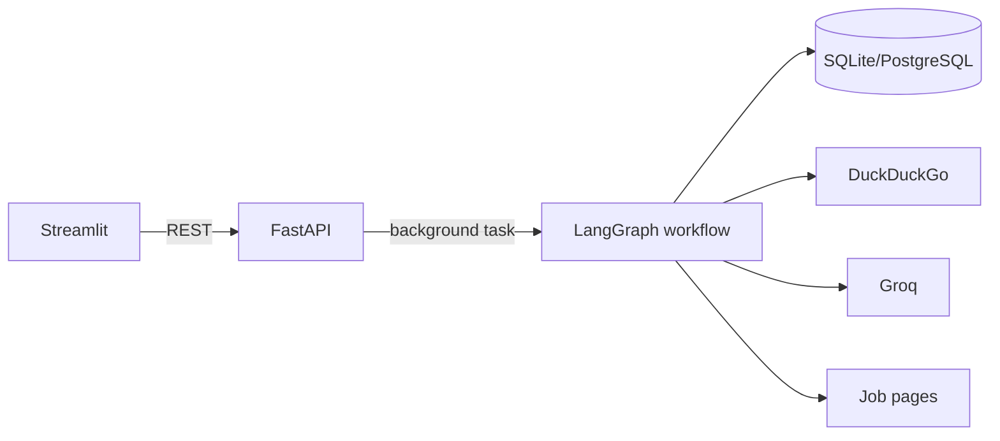
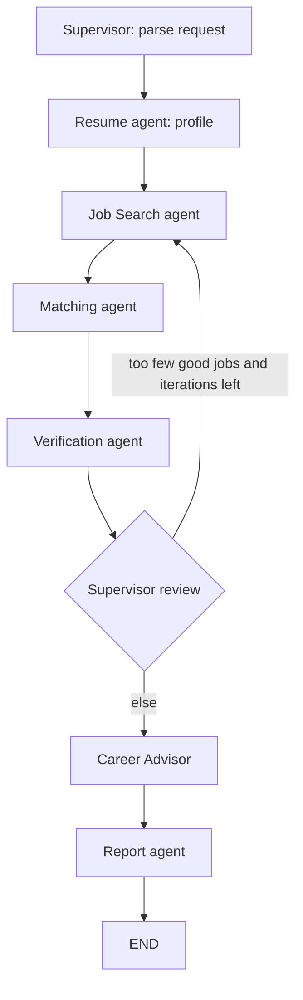

# CareerPilot AI — Multi-Agent Career & Job Intelligence System

Real LangGraph multi-agent app: live DuckDuckGo web search (no API key) → resume parsing → explainable matching → SSRF-safe job verification → career advice → ranked report. FastAPI backend, Streamlit UI, SQLAlchemy persistence (SQLite by default, PostgreSQL supported).

**Status:** 42 pytest tests pass with mocked external APIs. Live DuckDuckGo/Groq calls were **not** exercised in the build environment (no internet/keys) — run the live checks below with your own keys. No accuracy metrics are claimed; `scripts/evaluate.py` measures them on your data.

## Setup (Windows PowerShell)
```powershell
cd careerpilot-ai
python -m venv .venv
.\.venv\Scripts\Activate.ps1
pip install -r requirements.txt
Copy-Item .env.example .env     # then edit .env and add GROQ_API_KEY (optional)
pytest -q                       # unit tests (no keys needed)

# Terminal 1 (API)
uvicorn app.main:app --port 8000 --reload
# Terminal 2 (UI)
streamlit run frontend/streamlit_app.py
```
API docs: http://localhost:8000/docs · UI: http://localhost:8501

**Search / keys / limits:** Search uses DuckDuckGo through the open-source `ddgs` package: free, no account or key. It is unofficial scraping, so it can be rate-limited or return empty results; the app retries a bounded number of times, then reports the failure (never fake data). Queries run 2 at a time to stay gentle. `ddgs` is community-maintained and its behaviour can change; if it breaks, upgrade it (`pip install -U ddgs`) or set `SEARCH_PROVIDER=tavily` with a `TAVILY_API_KEY` (paid-tier-limited, see tavily.com pricing). Groq (console.groq.com) is optional: without `GROQ_API_KEY`, request parsing and advice use clearly-labelled rule-based fallbacks. Change `GROQ_MODEL` if the default is retired; check that your model supports tool calling.

**Smoke test with live keys:** `curl http://localhost:8000/health` should show `search_ready: true`; then run a search in the UI and confirm real source URLs appear.

## Architecture


| Agent | File | Real tools |
|---|---|---|
| Supervisor | `agents/supervisor.py` | Groq tool-calling (forced function call), bounded routing (`MAX_ITERATIONS`) |
| Job Search | `agents/job_search_agent.py` | DuckDuckGo (`ddgs`) or Tavily, concurrent queries, URL dedupe |
| Resume | `agents/resume_agent.py` | PyMuPDF; nothing inferred (years of experience only if stated) |
| Matching | `agents/matching_agent.py` | Skill vocabulary + cosine similarity (Sentence Transformers if enabled) |
| Verification | `agents/verification_agent.py`, `tools/webpage_verifier.py` | httpx, SSRF guard, manual redirect checks |
| Advisor | `agents/career_advisor_agent.py` | Groq JSON mode; labelled AI-generated |
| Report | `agents/report_agent.py` | Ranking, CSV (formula-injection safe), Markdown |

Events shown in the UI are written by workflow nodes as they actually run (table `agent_events`); there are no scripted delays. Progress uses polling of `GET /api/search/{id}`.

## Match score
`score = 100 · Σ wᵢ·cᵢ / Σ wᵢ` over components that have data (missing components are dropped and weights renormalised). Defaults: skills 0.40, semantic 0.20, role 0.15, experience 0.10, education 0.05, location 0.10; override via `MATCH_WEIGHTS` JSON. Skills component = (required matched + 0.5·preferred matched) / (required + 0.5·preferred). Semantic similarity uses `sentence-transformers/all-MiniLM-L6-v2` when `USE_SENTENCE_TRANSFORMERS=1` and the package is installed, otherwise a lexical cosine (the backend is recorded in each result). It is an interpretable heuristic, **not** a hiring probability.

## Verification statuses
`verified_open` requires: HTTP 200 + official/ATS source + apply evidence (or JobPosting data with future `validThrough`) + job title on page + no closed-language. Aggregators with apply evidence are at most `likely_open`. Reachable but no evidence → `uncertain`. 404/410/closed text/past `validThrough` → `expired_or_closed`. 403/429/timeouts/blocked → `inaccessible` (explicitly *not* treated as closed). Pages are only pattern-matched, never fed to an LLM (prompt-injection safe).

## API
`GET /health` · `POST /api/search` (202) · `GET /api/search/{id}` · `POST /api/resume/analyze` · `POST /api/resume/compare` (resume file/text + job description) · `POST /api/jobs/match` · `POST /api/jobs/verify` · `GET /api/jobs` · `POST /api/jobs/save` · `GET /api/jobs/saved` · `DELETE /api/jobs/saved/{id}` · `GET /api/applications` · `PATCH /api/applications/{id}` · `GET /api/reports/{id}` · `GET /api/reports/{id}/csv` · `GET /api/dashboard`. List endpoints take `limit`/`offset`.
```powershell
curl -X POST http://localhost:8000/api/search -H "Content-Type: application/json" -d '{\"query\":\"fresher GenAI engineer in Hyderabad\"}'
```

## Security
Secrets only via env; PDF type/size/magic-byte checks, in-memory parsing, resume text never stored or logged; SSRF guard (http/https, ports 80/443, public IPs only, re-validated on every redirect, max 5 hops, 400 KB body cap); per-IP rate limit; bounded retries; no auto-apply/email features.

## Testing & evaluation
`pytest -q` (mocked). `scripts/evaluate.py report.json labels.json` computes duplicate rate, link accessibility and verification precision against your manual labels (`app/services/evaluation.py` also has relevance, score consistency and API-failure helpers). Latency is observable from `agent_events` timestamps.

## Deployment
API: Render/Railway/Fly — start `uvicorn app.main:app --host 0.0.0.0 --port $PORT`, set env vars, use a managed PostgreSQL `DATABASE_URL` (`postgresql+psycopg2://...`). UI: Streamlit Community Cloud with `frontend/streamlit_app.py` and secret `API_URL=https://<your-api>`; add that UI origin to CORS in `app/main.py`. Run a single API worker (rate limiter is in-memory).

## Limitations / future work
No authentication (single-user; add auth + `user_id` columns before multi-user hosting). DNS-rebinding between validation and fetch is not fully closed (pin resolved IP in a custom transport). Job fields come from search snippets via heuristics (company/location may be empty). JS-rendered or login-walled pages (LinkedIn etc.) usually end as `inaccessible`. The recency filter maps to DuckDuckGo's day/week/month/year time limit (coarse, based on the engine's own dating). No OCR for scanned PDFs, no PDF report export yet, background tasks are in-process (use a queue for scale), progress is polling not SSE.

## Resume line
Built CareerPilot AI, a 7-agent LangGraph system (FastAPI, Streamlit, PostgreSQL/SQLite) performing live DuckDuckGo job search, resume-to-job matching with explainable scoring, and SSRF-safe listing verification with evidence-based status.

## LinkedIn draft
Just built CareerPilot AI: a multi-agent job-intelligence app using LangGraph, Groq tool-calling and DuckDuckGo live search. It never claims a job is open without evidence, explains every match score, and tracks applications. Code + architecture on GitHub. #GenAI #LangGraph #AgenticAI

## Interview Q&A
- **Why LangGraph?** Explicit typed state, conditional edges (review → re-search) and bounded loops instead of free-form agent recursion.
- **How do you avoid hallucinated jobs?** Jobs come only from search results; unknown fields stay `None`; LLMs never write job data.
- **How is prompt injection handled?** Web pages are never given to an LLM; user/web text passed to LLMs is wrapped as data with instructions to ignore commands.
- **Why isn't "page loads" = "open"?** Needs apply evidence, title match, official/ATS source; blocked pages are `inaccessible`, not closed.
- **Score validity?** Weighted heuristic with documented formula; not predictive, tune weights/evaluate with labelled data.

## Application tracking
Applications happen on external sites, so the tracker is a personal log, not an automatic sync: click **Mark as applied** on a job (records today's date), then update status/notes on the Applications page.

## Roadmap
The Career Roadmap is generated automatically from your Resume Analyzer result (gaps vs. the pasted job description, or vs. your best-fit role when no JD is given) and from job-search results; switch between them on the page. Run Streamlit from the project root so `.streamlit/config.toml` (light theme) is applied.
